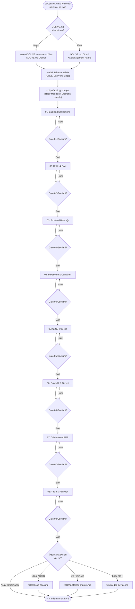

# Go-Live Skill (`golive-skill`)

[](https://github.com/Eyokurt/golive-skill)
[](https://www.python.org/)
[](LICENSE)
[](#-saha-dallari-field-branches)

**`golive-skill`**, yapay zeka kodlama ajanları (Google Antigravity, Claude, Cursor) ve modern DevOps/Mühendislik ekipleri için tasarlanmış **otonom, aşamalı ve durum takip eden bir canlıya alma (go-live) orkestratörüdür**.

Backend sertleştirmeden başlayarak kalite değerlendirmesi, frontend optimizasyonu, paketleme, CI/CD, güvenlik, gözlemlenebilirlik ve yayın/rollback adımlarını katı **çıkış kapıları (exit gates)** ile yönetir. Durum bilgisini projenin kök dizinindeki `GOLIVE.md` dosyasında saklar ve hiçbir aşamanın kapısı doğrulanmadan sonrakine geçişe izin vermez.

---

## 🎯 Temel Felsefe ve Dokunulmaz Kurallar

1. **Yıkıcı İşlemlerde Plan ve Onay Zorunluluğu (Safety Brake)**:
   - Veritabanı şeması değişiklikleri, pod durdurma, DNS yönlendirmesi veya altyapı güncellemeleri (`terraform apply`, `helm upgrade`) öncesinde kullanıcıya açık bir etki analizi sunulmalı ve açık onay alınmalıdır.
2. **Sıfır Secret Prensibi (Zero-Secrets-in-Code)**:
   - Parolalar, API token'ları, özel anahtarlar kesinlikle koda, commit geçmişine veya `GOLIVE.md` durum dosyasına yazılamaz; sadece Vault/KMS üzerinden yönetilir.
3. **Hedef Ortam ve Bağlam Doğrulaması (Context Verification)**:
   - Komut çalıştırılmadan önce aktif ortam (`$env:NODE_ENV`, `kubectl current-context`, AWS hesap kimliği) doğrulanır; yanlış hesapta işlem yapılması kesin olarak engellenir.

---

## 🔄 Yaşam Döngüsü ve Çalışma Akışı



---

## 🛠️ Çekirdek Aşamalar (Core Stages)

Her aşama dosyasında **Yapılacak Maddeler**, **Çıkış Kriteri (Gate)**, **Her Maddenin Nedeni (Rationale)** ve **Sık Yapılan Hatalar (Pitfalls)** standart olarak yer alır:

| No | Aşama Dosyası | Temel Odak | Çıkış Kapısı (Gate) Kriteri |
|:---|:---|:---|:---|
| **01** | [`01-backend-hardening.md`](core/01-backend-hardening.md) | Config şeması, fail-fast başlatma, global error handler, `/healthz` & `/readyz`, graceful shutdown, AI token/cost bütçe limiti ve fallback modeli. | Eksik env değişkeninde uygulamanın anında çökmesi; DB kesildiğinde `/readyz`'nin 503 vermesi; LLM maliyet limitinde 429 dönmesi. |
| **02** | [`02-quality-and-eval.md`](core/02-quality-and-eval.md) | Birim & entegrasyon testleri, E2E kritik akışlar, Golden eval veri seti, gecikme ve yük benchmark'ı. | Testlerin %100 yeşil olması; AI çıktılarının sıfır şema hatası vermesi; p95 yanıt süresinin SLA sınırlarında kalması. |
| **03** | [`03-frontend-readiness.md`](core/03-frontend-readiness.md) | Sıfır hata ile build, bundle optimizasyonu (<200KB initial), asset caching, 4-durumlu bileşenler, Error Boundary, Anti-AI-Slop standartları. | `npm run build` hatasız tamamlanması; ağ kopukluğunda sayfanın beyaz ekrana düşmemesi; emoji yasağına uyum. |
| **04** | [`04-packaging.md`](core/04-packaging.md) | Multi-stage Dockerfile, non-root kullanıcı, lockfile sabitleme, `.dockerignore`, Trivy CVE taraması. | Konteynerin `root` olmadan çalışması; imaj taramasında 0 CRITICAL CVE olması. |
| **05** | [`05-ci-cd.md`](core/05-ci-cd.md) | Sıralı otomatik pipeline (Lint -> Test -> Build -> Scan), OIDC ile buluta bağlanma, ana dal koruması, manuel prodüksiyon onay kapısı. | CI adımlarının hatasız tamamlanması; ana dala doğrudan push yasağının aktif olması. |
| **06** | [`06-security-and-secrets.md`](core/06-security-and-secrets.md) | Secret taraması (gitleaks), KMS/Vault entegrasyonu, kısıtlı CORS domainleri, CSP/HSTS başlıkları, rate limiting. | Git geçmişinde 0 sızıntı; bağımlılıklarda 0 CRITICAL/HIGH açık; CORS wildcard'ının bulunmaması. |
| **07** | [`07-observability.md`](core/07-observability.md) | Yapılandırılmış JSON loglama, Correlation/Trace ID, 4 altın sinyal, LLM maliyet/token telemetrisi, alarm eşikleri ve nöbetçi bildirimi. | Test isteği loglarının JSON formatında aynı trace_id ile düşmesi; deneme alarmının kanala ulaşması. |
| **08** | [`08-release-and-rollback.md`](core/08-release-and-rollback.md) | Sıfır kesinti dağıtım (Blue/Green, Rolling), geriye uyumlu DB migrasyonu (expand-and-contract), duman testleri, tek komutlu anında rollback. | Staging'de geri dönüşün denenmiş olması; duman testlerinin 0 hata ile geçmesi. |

---

## 🌐 Saha Dalları (Field Branches)

Projenin hedef dağıtım ortamına göre çekirdek sürece eklenen özel gereksinimler:

- ☁️ **Cloud / SaaS ([`fields/cloud-saas.md`](fields/cloud-saas.md))**:
  - Altyapı kod olarak tanımlı (IaC: Terraform, Pulumi); konsoldan elle müdahale (ClickOps) yasak.
  - DNS TTL sürelerinin düşürülmesi ve otomatik yenilenen TLS/SSL.
  - Yatay pod/sunucu ölçekleme (HPA) ve Kubernetes kaynak limitleri.
  - Bulut bütçe alarmları (FinOps) ve kademeli (Canary) trafik yönlendirme.
- 🏢 **Müşteri Ortamı ([`fields/customer-onprem.md`](fields/customer-onprem.md))**:
  - Tek parça kendi kendine yeten kurulum paketi (Docker Compose, Helm).
  - Tamamen internete kapalı (air-gapped) kurulum ve `precheck.sh` gereksinim doğrulayıcı.
  - Kurumsal proxy (`HTTP_PROXY`) ve kurum içi özel CA kök sertifikası desteği.
  - Çevrimdışı kriptografik lisans doğrulama ve tek komutluk log destek paketi (`support-dump.sh`).
  - Sıfır dış veri sızıntısı (KVKK / GDPR tam uyumu).
- 🤖 **Edge / Cihaz ([`fields/edge-device.md`](fields/edge-device.md))**:
  - Hedef işlemci mimarisine (ARM64, Jetson, RPi) göre çapraz derleme ve NPU/GPU sürücü uyumu.
  - Çevrimdışı çalışma (offline-first) ve yerel veritabanı (SQLite/RocksDB) ile store-and-forward senkronizasyonu.
  - A/B çift bölümlü güvenli OTA güncellemesi (Anti-Brick) ve donanımsal watchdog.
  - Flash bellek koruması (`tmpfs` loglama) ve termal kısılma dayanıklılığı.

---

## 🔍 Ön Tarama Betiği: `scripts/audit.py`

Depodaki mevcut hazır maddeleri tespit etmek, sahaları algılamak ve `GOLIVE.md` dosyasını otomatik senkronize etmek için harici bağımlılık gerektirmeyen (yalnızca standart kütüphane) Python betiği:

```powershell
# Mevcut depoyu tara ve terminal raporunu görüntüle
python scripts/audit.py --path .

# Sonuçları JSON formatında al
python scripts/audit.py --path . --json

# GOLIVE.md dosyası yoksa şablondan oluştur ve hazır maddeleri otomatik işaretle
python scripts/audit.py --path . --init

# Mevcut GOLIVE.md dosyasını tarama bulgularıyla güncelle
python scripts/audit.py --path . --sync
```

---

## 📦 Antigravity'ye Beceri Olarak Ekleme

Bu beceri Google Antigravity kullanıcı becerileri dizinine doğrudan kurulabilir:

```powershell
# Windows Antigravity global beceri dizinine kopyalama
Copy-Item -Path ".\golive-skill" -Destination "$env:USERPROFILE\.gemini\config\skills\golive-skill" -Recurse -Force
```

Kurulum tamamlandığında Antigravity sohbetinde aşağıdaki ifadelerden herhangi birini kullandığınızda beceri otomatik olarak devreye girer:
- *"deploy alalım"*
- *"projeyi canlıya alma sürecini başlat"*
- *"production'a çıkış için checklist oluştur"*
- *"go-live kontrolü yap"*

---

## 📂 Proje Yapısı

```
golive-skill/
├── SKILL.md                       # Antigravity orkestrasyon ve yönlendirme dosyası
├── README.md                      # Proje ana tanıtım ve dokümantasyon belgesi
├── LICENSE                        # MIT Açık Kaynak Lisansı
├── assets/
│   └── GOLIVE.template.md         # Projenin durumunu (state) tutan takip şablonu
├── scripts/
│   └── audit.py                   # Otomatik repo ön-tarama ve denetim aracı
├── core/                          # Çekirdek Aşamalar (Tüm sahalarda ortak)
│   ├── 01-backend-hardening.md
│   ├── 02-quality-and-eval.md
│   ├── 03-frontend-readiness.md
│   ├── 04-packaging.md
│   ├── 05-ci-cd.md
│   ├── 06-security-and-secrets.md
│   ├── 07-observability.md
│   └── 08-release-and-rollback.md
└── fields/                        # Saha Dalları (Ortama özel gereksinimler)
    ├── cloud-saas.md
    ├── customer-onprem.md
    └── edge-device.md
```

---

## 📄 Lisans

Bu proje [MIT Lisansı](LICENSE) altında sunulmaktadır.
