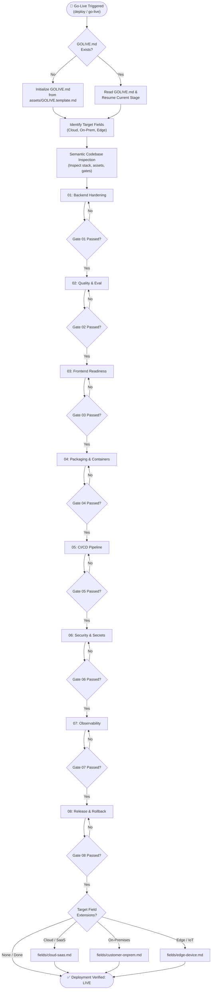

# Go-Live Skill (`golive-skill`)

[](https://github.com/Eyokurt/golive-skill)
[](#-zero-dependency-semantic-pre-audit)
[](LICENSE)
[](#-field-branches)

**`golive-skill`** is an autonomous, gate-driven production release and go-live orchestrator designed for AI coding agents (Google Antigravity, Claude, Cursor) and modern software engineering teams.

Starting from backend hardening, it systematically guides and verifies quality evaluation, frontend optimization, packaging, CI/CD, security, observability, and release/rollback procedures using strict **blocking exit gates**. It persists operational state within a repository-level `GOLIVE.md` file, guaranteeing that no phase is bypassed until its exit criteria are verified.

---

## 🎯 Core Philosophy & Prime Rules

1. **Safety Brake on Destructive Actions**:
   - Irreversible actions—such as dropping database columns, modifying DNS routing, terminating production containers, or applying infrastructure updates (`terraform apply`, `helm upgrade`)—require an explicit impact analysis presented to the user and **explicit confirmation** before execution.
2. **Zero-Secrets-in-Code Mandate**:
   - Passwords, API tokens, and private keys must never be committed to code, PR descriptions, or written into `GOLIVE.md`. Manage credentials strictly via Vault or KMS solutions.
3. **Target Environment & Context Verification**:
   - Verify active runtime context (`$env:NODE_ENV`, `kubectl current-context`, AWS account ID, database host) before executing commands to prevent running actions against the wrong environment.

---

## 🔄 Lifecycle & Workflow Architecture



---

## 🛠️ Core Stages

Every stage document standardizes on **Action Items**, **Exit Gate Criteria**, **Technical Rationale**, and **Common Pitfalls**:

| No | Stage File | Primary Focus | Blocking Exit Gate Criteria |
|:---|:---|:---|:---|
| **01** | [`01-backend-hardening.md`](core/01-backend-hardening.md) | Config schema validation, fail-fast init, global error handler, `/healthz` & `/readyz`, graceful shutdown, AI token/cost limits & fallback models. | Missing env variable triggers immediate exit; simulated DB outage causes `/readyz` to return HTTP 503; LLM cost cap returns HTTP 429. |
| **02** | [`02-quality-and-eval.md`](core/02-quality-and-eval.md) | Unit & integration tests, E2E critical flows, Golden eval dataset, latency budgets & load benchmark. | 100% passing tests; zero JSON schema violations on AI eval set; p95 latency adheres to SLA under 1.5x peak load. |
| **03** | [`03-frontend-readiness.md`](core/03-frontend-readiness.md) | Clean production build, bundle optimization (<200KB initial), asset caching, 4-state components, Error Boundaries, Anti-AI-Slop standards. | `npm run build` succeeds without type/lint errors; network disconnection does not cause blank screen; zero UI chrome emojis. |
| **04** | [`04-packaging.md`](core/04-packaging.md) | Multi-stage Dockerfile, non-root user (`USER`), pinned lockfiles, `.dockerignore`, image CVE scanner. | Container runs as non-root user (`whoami != root`); Trivy reports zero CRITICAL CVEs. |
| **05** | [`05-ci-cd.md`](core/05-ci-cd.md) | Automated pipeline (Lint -> Test -> Build -> Scan), OIDC cloud auth, branch protection rules, manual production gate. | CI pipeline completes cleanly; direct push to main branch is blocked; production deploy requires manual sign-off. |
| **06** | [`06-security-and-secrets.md`](core/06-security-and-secrets.md) | Secret scanning (gitleaks), KMS/Vault secret management, restricted CORS, CSP/HSTS headers, auth rate limiting. | Git history clean of secrets (0 leaks); zero CRITICAL/HIGH dependencies; wildcard CORS rejected. |
| **07** | [`07-observability.md`](core/07-observability.md) | Structured JSON logging, Correlation/Trace IDs, 4 golden signals, LLM telemetry & cost tracking, actionable alerting rules. | Test request logs appear formatted as JSON with matching trace_id; simulated alarm reaches designated notification channel. |
| **08** | [`08-release-and-rollback.md`](core/08-release-and-rollback.md) | Zero-downtime deployment (Blue/Green, Rolling), backward-compatible DB migrations (expand/contract), automated smoke tests, single-command rollback. | Rollback drill verified in staging; post-deploy smoke tests pass with 0 errors; error rate stable for 15 mins post-launch. |

---

## 🌐 Field Branches

Custom architectural requirements applied based on target operational environments:

- ☁️ **Cloud / SaaS ([`fields/cloud-saas.md`](fields/cloud-saas.md))**:
  - Declarative Infrastructure as Code (Terraform, Pulumi); zero manual console drift.
  - Reduced DNS TTL (60-300s) and automated TLS renewal with HSTS.
  - Horizontal Pod Autoscaling (HPA) and strict container CPU/RAM limits.
  - FinOps cloud budget alerts and weighted canary ingress routing.
- 🏢 **Customer On-Premises ([`fields/customer-onprem.md`](fields/customer-onprem.md))**:
  - Self-contained offline installation bundles (Helm, Docker Compose tarball).
  - Fully air-gapped installation verification with pre-flight host checks (`precheck.sh`).
  - Enterprise HTTP proxy and custom corporate Root CA certificate support.
  - Offline cryptographic licensing and single-command sanitized support dumps (`support-dump.sh`).
  - Zero external telemetry or third-party asset calls (strict GDPR/KVKK compliance).
- 🤖 **Edge / Device ([`fields/edge-device.md`](fields/edge-device.md))**:
  - Multi-architecture cross-compilation (ARM64, Jetson, RPi) and NPU/GPU accelerator drivers.
  - Robust offline-first operation with embedded persistence (SQLite/RocksDB) and store-and-forward sync.
  - Dual-partition fail-safe A/B OTA recovery (anti-brick protection) and hardware watchdogs.
  - Flash memory wear-out mitigation (`tmpfs` logging) and thermal throttling resilience.

---

## 🔍 Zero-Dependency Semantic Pre-Audit

Instead of relying on fragile regex scripts or external runtimes, the AI coding agent directly inspects the codebase using its native semantic tools:

1. **Stack & Tooling Discovery**: Identifies runtime, dependencies, package managers, and frameworks (`package.json`, `pyproject.toml`, `go.mod`, `Cargo.toml`).
2. **Production Asset Verification**: Confirms presence and quality of `Dockerfile`, `.dockerignore`, `.github/workflows`, test suites, and health check routes.
3. **Secret Hygiene**: Scans source files and git configurations to ensure `.env` is ignored and zero credentials exist in repository files.
4. **Automated State Tracking**: Automatically pre-checks satisfied items in `GOLIVE.md` before proceeding with sequential gate verification.

---

## 📦 Installing into Google Antigravity

Install this skill into your Antigravity user skills directory:

```powershell
# Copy skill into Antigravity global configuration directory
Copy-Item -Path ".\golive-skill" -Destination "$env:USERPROFILE\.gemini\config\skills\golive-skill" -Recurse -Force
```

Once installed, triggering phrases will automatically engage the skill in conversation:
- *"let's deploy this project"*
- *"start the go-live process"*
- *"prepare a production release checklist"*
- *"run pre-deployment audit"*

---

## 📂 Repository Structure

```
golive-skill/
├── SKILL.md                       # Antigravity orchestration and routing entrypoint
├── README.md                      # Comprehensive project documentation
├── LICENSE                        # MIT Open Source License
├── assets/
│   └── GOLIVE.template.md         # State tracking template
├── core/                          # Universal Core Stages
│   ├── 01-backend-hardening.md
│   ├── 02-quality-and-eval.md
│   ├── 03-frontend-readiness.md
│   ├── 04-packaging.md
│   ├── 05-ci-cd.md
│   ├── 06-security-and-secrets.md
│   ├── 07-observability.md
│   └── 08-release-and-rollback.md
└── fields/                        # Deployment Field Extensions
    ├── cloud-saas.md
    ├── customer-onprem.md
    └── edge-device.md
```

---

## 📄 License

This project is licensed under the [MIT License](LICENSE).
